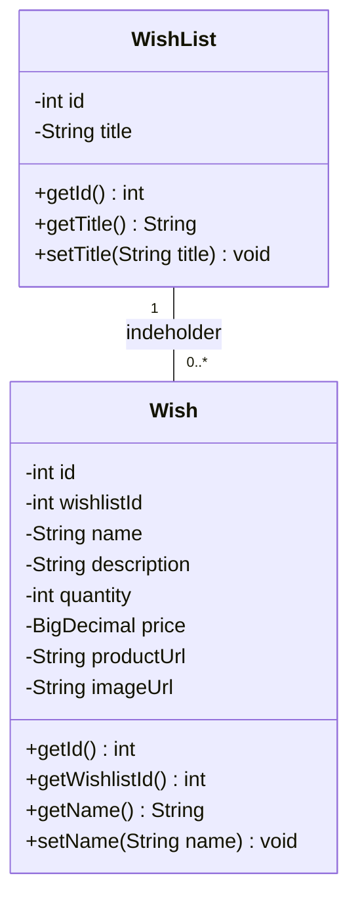
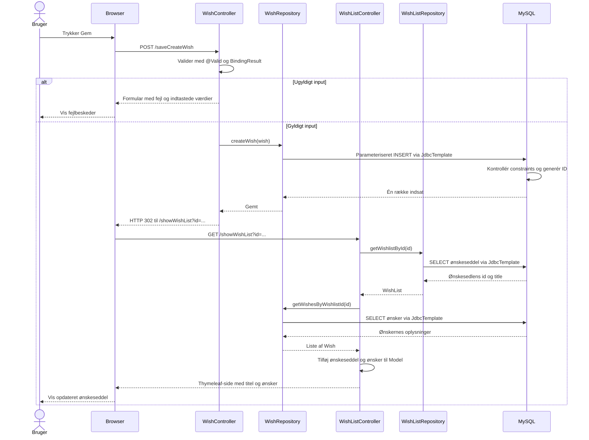
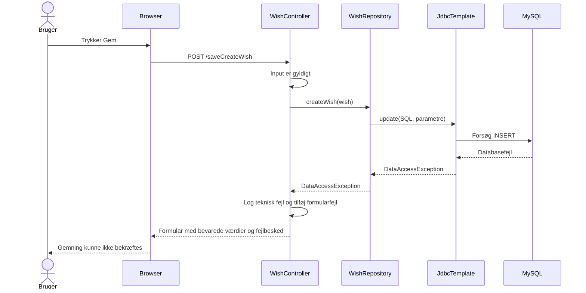
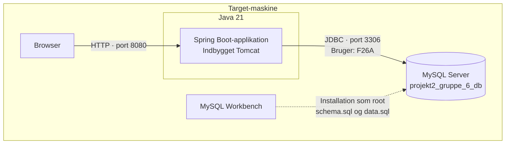

# Diagrammer – Ønskeskyen

Diagrammerne beskriver den planlagte implementering. Klasser, controller-endpoints og fejlhåndtering skal implementeres og testes, før de kan betragtes som dokumentation af fungerende kode.

## Klassediagram

Getters og setters er forkortet. Hvert ønske tilhører præcis én ønskeseddel via `wishlistId`. En ønskeseddel kan indeholde nul eller flere ønsker. Repositoryet henter ønskerne, så `WishList` behøver ikke en `List<Wish>` i første version.

Pris bruger `BigDecimal`, som passer til MySQL-feltet `DECIMAL(10,2)`. Titel og navn skal være udfyldt, antal skal være positivt, og en angivet pris skal være mindst nul.

## Sekvensdiagram – Gem et ønske

`JdbcTemplate` er samlet i repositoryernes databasekald for at holde hoveddiagrammet læsbart. Databasefejl vises separat nedenfor.

## Sekvensdiagram – Databasefejl under Gem

Foreslået håndtering: Controlleren håndterer `DataAccessException`, bevarer formularens værdier og viser en generel fejlbesked.

Brugerbesked:

> Vi kunne ikke bekræfte, at ønsket blev gemt. Kontrollér ønskesedlen, før du prøver igen.

En mistet forbindelse kan i enkelte tilfælde betyde, at databasen har gemt ønsket, men at svaret er gået tabt. Derfor vises ingen falsk bekræftelse, og der foretages ikke automatisk et nyt forsøg. Fejl ved genindlæsning efter redirect og manglende ønskeseddel er ikke vist i disse diagrammer.

## Deployment – én target-maskine

Dette er en deployment-visning med Mermaids flowchart-symboler. Alle dele kører på samme computer. Workbench bruges til opsætning; Spring Boot kommunikerer direkte med MySQL under drift. Installationen er beskrevet i [README](../README.md).

## Enkel forklaring til holdet

Når brugeren trykker **Gem**:

1. Formularen sender oplysningerne til controlleren.
2. Controlleren kontrollerer input. Ved fejl vises formularen igen med fejlbeskeder.
3. Repositoryet gemmer gyldige oplysninger i MySQL gennem `JdbcTemplate`.
4. Browseren sendes videre til ønskesedlen.
5. Applikationen henter titel og ønsker fra databasen og viser den opdaterede side.

Hvis databasen fejler, viser vi en forståelig fejlbesked og bevarer det indtastede. Vi fortæller ikke brugeren, at ønsket er gemt.

Vi har delt flowet i to sekvensdiagrammer, så det normale flow og databasefejl er lette at følge. Koden skal implementeres og testes, så den følger diagrammerne.

## Wireframes og ER-diagram

Begge findes på det samme tldraw-board:

- [Wireframes – desktop og mobil](https://www.tldraw.com/f/SC8uJKYfJs_BzxX0tho5A): Find skærmene til højre for de oprindelige diagrammer.
- [ER-diagram med Chen-notation](https://www.tldraw.com/f/SC8uJKYfJs_BzxX0tho5A): Find diagrammet med entiteter som rektangler, attributter som ovaler og relationen som en rombe.

Mermaid-filerne i GitHub er fremover reference for klasse-, sekvens- og deployment-diagrammer. Ældre versioner af klasse- og sekvensdiagrammer på tldraw-boardet kan være forældede.
